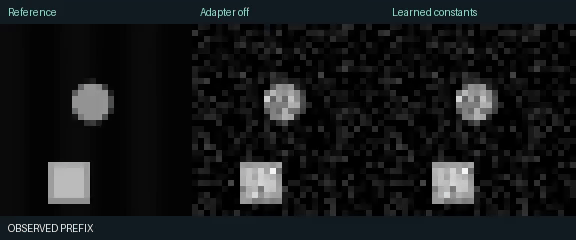

# Nopee

**A little space. A little memory. An honest comparison.**

A small, trained video-prediction experiment that runs on CPU or your own GPU.
Give it four observed frames; it predicts what comes next. Compare a shared base
predictor against a centre–surround / E–I-inspired memory adapter, with fixed,
learned and shuffled constants. See the actual forecasts, errors and runtime.

**This is a research toy, not a Wan replacement or text-to-video generator.**
It predicts 32×32 grayscale moving shapes. Real videos and webcam recordings are
supported as explicitly out-of-distribution tests; realistic footage may fail badly.
There are no living-neuron measurements, proprietary TBC weights, remote inference
calls or claims of a biological breakthrough. A trained checkpoint is included:
the demo does not quietly train a model when you start it.



**Bundled result:** the full adapter did not improve overall accuracy. Removing its
spatial filter helped in this small run. The negative result and interventions are
included in the [demonstration ledger](results/DEMO.md).

## Run locally

Python **3.12** is the tested choice. On Windows, use it explicitly if your default
Python is newer. In PowerShell, from the downloaded/cloned repository:

```powershell
py -3.12 -m venv .venv
.\.venv\Scripts\python.exe -m pip install -r requirements.txt
.\.venv\Scripts\python.exe app.py
```

Open **http://localhost:7860**. Linux/macOS:

```bash
python3.12 -m venv .venv
source .venv/bin/activate
python -m pip install -r requirements.txt
python app.py
```

The dependencies select a CPU PyTorch wheel by default. For CUDA, first install an
appropriate PyTorch CUDA build using the [official selector](https://pytorch.org/get-started/locally/),
then install the remaining requirements. The model is tiny; the RTX 3060's 12 GB is
ample for the default 32×32 experiment, but CUDA performance was not measured here.

```powershell
$env:NOPEE_DEVICE="cuda"
.\.venv\Scripts\python.exe app.py
```

CPU is the default for the app, even if a GPU is available. `NOPEE_THREADS` defaults
to 2; `NOPEE_CHECKPOINT` selects another checkpoint directory. Once dependencies
are installed, the bundled model and toy world run offline. Webcam recording in a
browser needs camera permission; localhost or HTTPS is required by browsers.

## Hugging Face Spaces

1. Create a **Gradio / CPU Basic** Space.
2. Upload this repository's files, preserving `nopee/` and `checkpoints/demo/`.
   Include this README, `app.py`, `requirements.txt`, both checkpoint files and all
   Python source. Do not upload `.venv/`, `.git/`, `runs/` or `outputs/`.
3. The YAML above selects `app.py`, Python 3.12 and Gradio 5.49.1. No token, model
   download or GPU allocation is needed for inference.

This repo is Space-ready; creating a GitHub repository does **not** automatically
create a running Space. A static GitHub Pages site cannot execute this Python app.
On a hosted Space, uploaded/webcam clips are sent to that server; use the local
app for local processing. Clips are not used for training. Gradio's file cache is
configured for hourly cleanup; on each new request, derived export folders older
than an hour are removed, with at most 64 such folders retained.

## What you can try

- **Moving world:** new deterministic scenes, observation noise, forecast length,
  1/2/4 refinement calls, and three adapter variants.
- **Your video / webcam:** observe the first four frames and forecast the remaining
  reference frames. Inputs are sampled at 8 fps, resized to 32×32 and capped at
  28 frames / 50 MB. No future reference pixels feed the predictor.
- **Interventions:** clear memory at each frame, bypass the spatial filter, or
  reassign trained constants without retraining.
- **Measurements:** a comparison MP4, error-by-frame plot, numerical table and
  downloadable JSON with checkpoint provenance.

## What the model actually does

The convolutional base reads the last two frames and their difference. Its iterative
refinement network estimates a bounded displacement field and small appearance
correction. It backward-warps the last frame to form the next prediction. Additional
refinement calls are real network evaluations, **not diffusion sampling steps**.

The adapter adds a parallel feature branch:

1. Project base features into eight channels.
2. Apply a normalized `Gaussian(λ) − Gaussian(2λ)` kernel, with zero response to
   spatially constant inputs (replicated boundary padding).
3. Update two signed fields, E and I, with a damped rotation and input drive:

   `E_next = r (cos(ω) E − sin(ω) I) + (1 − r) drive`

   `I_next = r (sin(ω) E + cos(ω) I)`, where `r = exp(−1/τ)` and `ω = 0.45`.

4. Project those fields back into a bounded residual on the base features.

The homogeneous update has spectral radius `r < 1`. Memory advances **once per
video frame**, not per refinement call. These are signed mathematical fields,
not nonnegative firing rates or a detailed neuronal simulation. Lambda is measured
in **pixels**, tau in **frames**; no conversion from biological millimetres or
milliseconds is asserted. Unlike SignalIsASignal, there is no learned hard routing
gate here that preserves selected modules exactly.

## Controls and what they can establish

| Condition | Constants | Training |
|---|---|---|
| Adapter off | No branch | Shared trained base |
| Synthetic fixed | Eight λ values from 0.6–1.6 px; τ from 2–8 frames | Projections trained; base frozen |
| Learned | Same initialization; λ bounded to 0.4–2 px, τ to 1–12 frames | Constants and projections trained; base frozen |
| Shuffled fixed | Independently permuted fixed λ and τ assignments | Projections trained; base frozen |
| Persistence | Last observed frame repeated | None |
| Linear | Clipped pixelwise temporal extrapolation | None |

Adapter variants start with identical projection weights and receive identical
training worlds, noise, refinement budgets and optimizer steps. The shared base
never changes during adapter training. The full model is about nine thousand
parameters; see checkpoint metadata for exact counts.

**A retrained shuffle is not a decisive biological control:** its projections may
compensate for reassigned channels. The inference-time shuffle is a separate
intervention and can cause distribution shift. To test biological specificity,
we would need an actual dataset of measured constants, a defensible unit mapping,
and stronger matched conventional-adapter controls. This implementation does not
settle that question. Nor does it isolate spatial filtering from memory through
separately retrained single-component models; the UI interventions are ablations
of an already trained system.

## Reproduce and extend

```bash
# Bundled checkpoint recipe: about a few minutes on the development CPU.
python -m nopee train --seed 0 --base-steps 600 --adapter-steps 200 --batch 8 --device cpu --output runs/seed0

# Paired held-out worlds; all six systems, all three neural budgets.
python -m nopee benchmark --checkpoint runs/seed0 --sequences 12 --seed-start 90000 --output outputs/seed0

# Repeat the mechanism intervention on the same evaluation worlds.
python -m nopee benchmark --checkpoint runs/seed0 --intervention reset_memory --output outputs/reset

# Longer training on a local CUDA installation.
python -m nopee train --seed 1 --base-steps 3000 --adapter-steps 1500 --device cuda --output runs/seed1
```

Repeat seeds 1, 2 and 3; do not report only the best run. Keep each output directory
separate. Changing `NOPEE_CHECKPOINT` requires restarting the app because it caches
loaded weights. Training never overwrites the bundled checkpoint unless you explicitly
choose that output path.

`weights.npz` contains arrays only (loaded with `allow_pickle=False`). `metadata.json`
records training steps, world seeds, constants, parameter counts, versions, source
hashes and the weight checksum. A CLI benchmark rejects known training-seed overlap.
`benchmark.json`, `summary.csv` and `per_sequence.csv` retain the paired measurements.

## Read the results carefully

- **MSE / PSNR:** whole-frame accuracy; background can dominate.
- **Foreground MSE:** error where the reference contains bright objects.
- **Motion error:** squared error of predicted versus reference temporal differences.
  It can still favour persistence on hard motion: read it alongside spatial metrics.
- **Latency:** warm, synchronized median per sequence, including observed-prefix
  processing and excluding file encoding. These are host-specific measurements;
  no simulated GPU timings, energy estimates or advertised speedup.

See [the bundled demonstration ledger](results/DEMO.md). It is a single training
seed and a small evaluation, **not a preregistered study**. Architecture was adjusted
during development after visually checking blur in an initial pixel-only predictor.
Do not interpret a favourable example as proof that these constants are special.

## Tests

```bash
python -m pip install -r requirements-dev.txt
python -m pytest -q
```

Tests cover causal rollout, per-frame memory timing, stable decay, zero-DC spatial
filtering, matched initialization and frozen base weights, checkpoint roundtrips,
metrics, video decoding/export and app callbacks. GitHub Actions runs the suite
and a small benchmark on each push.

## Origin and scope

Antti's Sihti / Janus / SignalIsASignal discussions motivated the experiment.
TBC's [Oasis hypercolumn research post](https://www.tbc.co/post/a-sense-of-space-and-time-optimizing-interactive-video-generation)
motivated testing spatial filtering and temporal memory together. This is an
independent miniature experiment, not a reproduction of their commercial model.
The source is MIT licensed. No TBC code, weights or biological recordings are included.
